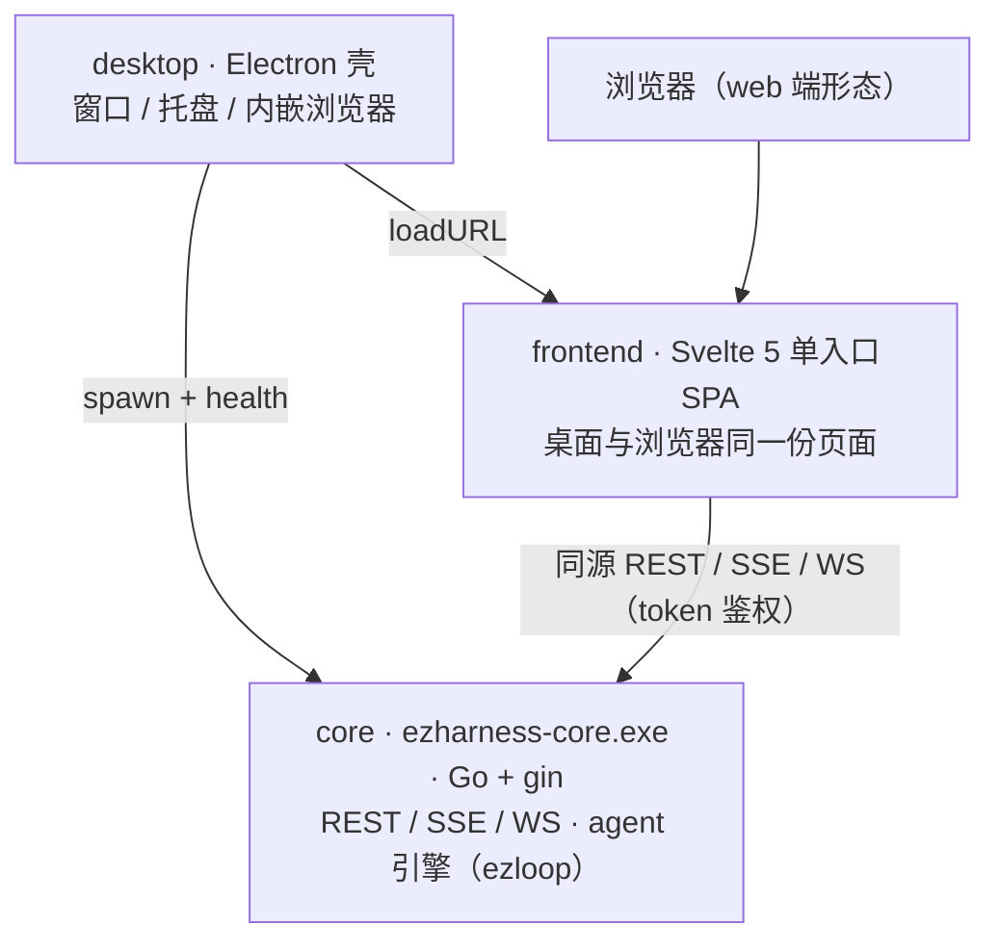

<div align="center">


# ezharness

**简单，交给用户。**

一个 exe · 三重角色 · 零配置 —— 为用户提供最简单交互方案的桌面智能体 harness

[](https://github.com/xuanlv2002/ezharness/releases)
[](https://github.com/xuanlv2002/ezharness/releases)
[](LICENSE)
[](https://xuanlv2002.github.io/ezharness/)
[](https://go.dev)
[](https://svelte.dev)
[](https://www.electronjs.org/)

**简体中文** · [English](README.en.md)

</div>

## 功能演示

<p align="center">
  <!-- 功能演示 GIF：录好后放到 docs/gif/demo.gif，取消下面这行注释即可 -->
  <!--  -->
  <sub>GIF 占位 · docs/gif/demo.gif</sub>
</p>

## 这是什么

ezharness 是一个跑在你电脑上的 AI 助手：它能读写整台设备的文件、操作真实终端与浏览器，同时把每一步都摊开给你看、随时交还给你管。

它只做三件事：

| 支柱 | 关注点 |
| --- | --- |
| **上下文工程** | 什么进上下文、何时折叠、如何让模型始终知道自己是谁、在哪、用户最近干了什么 |
| **工具封装** | 把系统能力（文件、终端、浏览器、画板、MCP 等）封装成安全可控、即取即用的工具 |
| **交互方案设计** | 对话之外的协同通道：决策卡、全局通知、共享终端与浏览器 |

## 主要特性

- **树状会话**：多线并行，任意消息可分叉探索不同方案；长对话归档为记忆后换代，切线不打断后台运行
- **人机协同终端**：人和 agent 共用同一个真实 shell——你随时接管，你敲的命令它下一轮就知道
- **共享浏览器**：内嵌真实 Chromium，agent 经工具操作、你在同一页面原生接管
- **决策卡与全局通知**：四档审批策略（每次审批 / 黑名单 / 白名单 / 全免审）即时生效；任何分支需要人时，通知一定能找到你
- **魔法画板**：标注截图、白板创作，结果回填为对话附件
- **快应用**：agent 生成的小工具（html 等）一键启动为独立子窗口，可直接调用 MCP 工具
- **MCP**：接入外部工具服务器（http / stdio），探活、启停、热加载
- **记忆三件套**：长期记忆（索引进上下文，按需检索）、能力记忆（skill 技能库）、话题记忆（会话归档）
- **模型三槽**：main / image / audio 单选槽位，各自带用量统计；图片识别由主模型多模态承担
- **安全**：全 API 令牌鉴权 + 同源放行；工具审批四档；终端命令包含匹配拦截（宁误拦不漏拦）

## 快速开始

从 [Releases](https://github.com/xuanlv2002/ezharness/releases) 下载。**exe 在哪运行，配置与数据就在哪生成。**

**绿色版（免安装）**

1. 下载 `ezharness-v<版本>.exe`（可改名 `ezharness.exe`），放入任意文件夹，如 `D:\ezharness`；
2. 将该文件夹加入 PATH；
3. 终端输入 `ezharness` 启动，首次运行在同目录生成 `ezharness.json` 与 `data\`。

**安装包**

1. 下载并运行安装包；
2. 按引导选择安装目录，自动创建开始菜单与桌面快捷方式，可选「添加到 PATH」。

**纯 server 形态**

直接运行 `ezharness-core.exe`，浏览器访问 `http://127.0.0.1:<port>`。与桌面端同一份页面，桌面专属能力（如浏览器控制）自动降级。

### 30 秒上手

1. 打开「模型」页，填入 apiKey 并选择模型；
2. 回到对话页，把任务交给它——文件整理、脚本编写、报错排查、网页操作都行；
3. 它需要你时（审批 / 提问），决策卡会出现在时间线与顶栏通知里。

## 核心玩法

| 场景 | 怎么玩 |
| --- | --- |
| [会话分叉](docs/md/session.md) | 对任意消息点「分叉」复制前缀开新线，多方案并行对比；「归档」把长对话沉淀为记忆并换代 |
| [共享终端](docs/interaction.md) | 拉开工作区抽屉的终端：agent 正在跑的命令你能看见、能接管 |
| 共享浏览器 | 让 agent 打开网页操作，浏览器窗口自动弹出共见；你在同一页面随时接管 |
| 魔法画板 | 丢一张截图进画板，圈注要改的地方，一键回填给 agent |
| [快应用](docs/md/runtime.md) | 让 agent 做个小工具页面，生成后一键启动为子窗口 |
| [MCP](docs/md/architecture.md) | 设置页添加 MCP server，agent 自动发现工具；快应用也能直调 |

## 架构一瞥

三层结构，业务全在一个 Go sidecar 里，桌面壳只做壳：



与姊妹仓库 [ezloop](https://github.com/xuanlv2002/ezloop) 的分工：ezloop 是精简的 agent loop 引擎（模型与工具的循环、hook / warp 扩展点、fork 分身）；ezharness 在其上做会话管理、上下文工程、工具封装与人机交互设计。

## 文档

**[在线文档](https://xuanlv2002.github.io/ezharness/)**（支持中英文切换，按由浅入深组织）：

| 层 | 内容 | 入口 |
| --- | --- | --- |
| 快速上手 | 安装、配置模型、第一轮对话 | 本页 + [快速上手](https://xuanlv2002.github.io/ezharness/#start) |
| 用户指南 | 会话 / 终端 / 浏览器 / 画板 / 快应用 / MCP | [用户指南](https://xuanlv2002.github.io/ezharness/#guide) |
| 核心概念 | 树状会话、上下文工程、人机协同交互 | [核心概念](https://xuanlv2002.github.io/ezharness/#concepts) · [interaction.md](docs/interaction.md) |
| 深入设计 | 架构、hook 全景、存储格式、上下文全动作 | [架构深读](https://xuanlv2002.github.io/ezharness/architecture.html) · [docs/md/](docs/md/) |
| 参考 | 构建方案、开发备忘 | [build.md](docs/build.md) |

## 从源码构建

前置依赖：[Go](https://go.dev/dl/)、[Node.js](https://nodejs.org/)（含 npm）。Electron 下载已配 npmmirror 镜像（`desktop/.npmrc`）。

版本单源为 `script/version.yaml`，构建时自动同步页脚与打包版本。脚本可从任意目录调用：

```sh
script\dev.bat           # 调试：前端构建 + core 编译，前台启动 Electron
script\build.bat         # 发布打包 -> release\v<版本>\ 安装包 + 绿色版
```

需要修改 [ezloop](https://github.com/xuanlv2002/ezloop) 本身时，在 `core/go.mod` 用 `replace` 指向本地仓库。

## 贡献

欢迎 issue 与 PR。深读设计见[在线文档](https://xuanlv2002.github.io/ezharness/)，构建与开发约定见 [build.md](docs/build.md)。

## 许可

[Apache-2.0](LICENSE)

---

<div align="center">

**ezharness** — 简单，交给用户。

</div>
