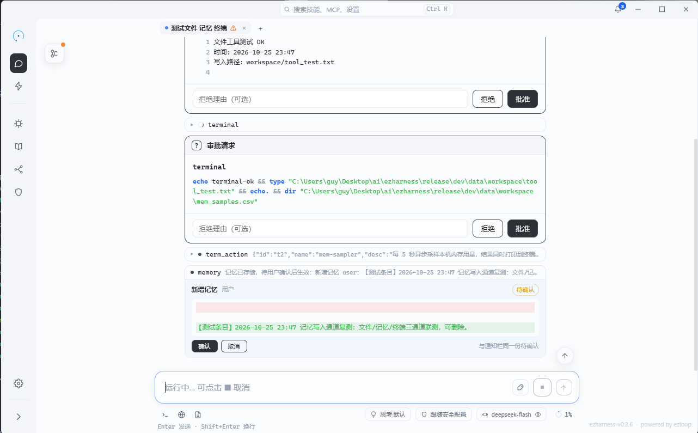

# 工具快查

这是 agent 实际可调用的工具、参数与默认审批速查。工具清单随内核装配生成；这里只记「怎么调、边界在哪」。


## 一、文件与终端

| 工具 | 参数 | 返回 / 边界 | 默认 |
| --- | --- | --- | --- |
| `read_file` | `path`、`offset?`、`limit?`、`note?` | 文本或图片标记；2000 行、20 万字符、图片 8MB | 免审 |
| `write_file` | `path`、`content` | 写入字节数 | 审批；路径白名单内免审 |
| `edit_file` | `path`、`old_text`、`new_text` | 替换次数；全部命中才原子写入 | 审批；路径白名单内免审 |
| `terminal` | `command`、`timeout_s?` | stdout + stderr + exit code；默认 600 秒，上限 3600 秒 | 命令白名单内免审，否则审批 |

`read_file` 读到图片时返回图片标记，由引擎在下一轮转成图片消息；`note`（看图目的）会随图片一起写入该消息。无视觉模型会被拒绝。

## 二、共享终端与浏览器

| 工具 | 参数 | 返回 / 边界 | 默认 |
| --- | --- | --- | --- |
| `term_tab` | `action`（new / list / close）、`name?`、`desc?`、`tabId?` | 终端标签信息 | list 免审，其余审批 |
| `term_action` | `action`（send / read）、`tabId`、`command?`、`lines?` | send 返回前后屏差异；read 返回末尾 N 行（默认 100） | send 白名单内免审；read 免审 |
| `browser_tab` | `action`（open / list / select / close）、`url?`、`tabId?` 等 | 标签信息 | list 免审，其余审批 |
| `browser_action` | `action` 七选一、`tabId`、`url?`、`selector?`、`js?`、`note?`、`files?` 等 | 页面文本 / 控制台 / 网络 / 截图路径 | 免审 |

`browser_action` 的七个动作：`navigate`、`read`、`eval`、`console`、`network`、`screenshot`、`upload`。点击、输入、滚动都通过 `eval` 完成。

### eval 示例

```js
// 点击「保存」按钮
__ezOne('button[data-action="save"]')?.click()

// 读取列表里的所有标题
__ezAll('.item .title').map((el) => el.textContent.trim())
```

`__ezOne` / `__ezAll` 是页面上下文里注入的查询辅助函数。

## 三、编排与记忆

| 工具 | 参数 | 返回 / 边界 | 默认 |
| --- | --- | --- | --- |
| `task` | `task`、`model?` | 分身执行的最终答案 | 免审 |
| `ask_user` | `question`、`options?` | 用户回答；阻塞等待 | 免审 |
| `plan` | `action`（new / update / clear）、`plan?`、`progress?` | 计划面板状态 | new 审批，其余免审 |
| `memory` | `action`（add / update / remove / project-save / project-remove / project-read）、`target?`、`id?`、`text?` 等 | 待确认操作 JSON | 免审；变更须用户确认 |
| `model_call` | `prompt`、`model?`、`images?` | 模型文本；最多 4 张图、5 分钟 | 免审 |
| `sleep` | `seconds`（1–900） | 等待 | 免审 |

## 四、技能、MCP 与上下文

| 工具 | 参数 | 返回 / 边界 | 默认 |
| --- | --- | --- | --- |
| `load_skill` | `name` | 技能全文 + 目录树 | 免审 |
| `mcp_router` | `action`（mcp_list / tool_list / tool_call）、`server?`、`tool?`、`args?` | 服务器 / 工具 / 调用结果 | 发现免审，调用审批 |
| `trim_context` | 无 | 就地折叠上下文，产出四节摘要 | 免审 |
| `save_app` | `name`、`html`、`title?`、`version?`、`backend?` 等 | 应用路径 | 免审 |
| `load_app` | `name` | 元数据 + 文档 + CHANGELOG | 免审 |

## 五、审批规则

四档策略在设置页选择，即时生效：

| 档位 | 行为 |
| --- | --- |
| 每次审批 | 除免审名单外全部询问 |
| 黑名单 | 列表内询问，其余放行 |
| 白名单 | 列表内放行，其余询问 |
| 全免审 | 不询问（谨慎使用） |

具体判定：

- 所有 `list` 类动作恒免审：`term_tab list`、`browser_tab list`、`mcp_list`、`tool_list`。
- 命令与路径白名单分别作用于 `terminal` 与文件写入类工具。
- 未登记默认值的工具一律按「需要审批」处理，宁烦不漏。
- 全局策略可以覆盖单工具的默认值。

审批卡出现在时间线里，同时顶栏通知会提醒；切到任何分支都能看到属于那条线的待处理请求。

<figure>
  
  <figcaption>审批卡带着完整参数出现在时间线里：可批可拒，拒绝理由会回给模型</figcaption>
</figure>

## 六、结果多大才会被卸载

超过阈值（默认 4096 字节）的工具结果会被卸载到文件，上下文只保留 512 字节头与绝对路径。豁免：`ask_user`、`task`、`load_skill`、`read_file`（回放工具）。阈值可在设置页调整，上限 1MB。

详见[上下文管理](上下文设计.md)。

---

上一篇：[快应用](快应用.md) · 回到[设计理念](设计理念.md)
