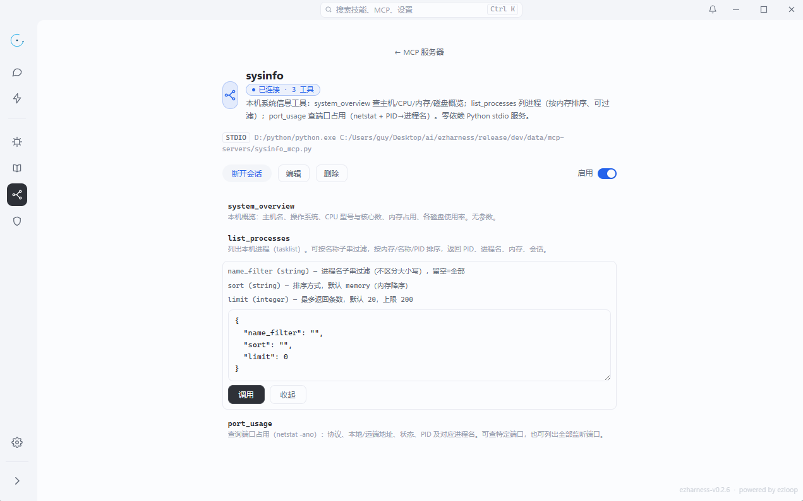

# MCP 设计

MCP 让 agent 接入外部工具服务器。ezharness 除了把 MCP 工具交给模型，也把同一批连接暴露为本机 API——页面、快应用、脚本可以直接调用。

<figure>
  
  <figcaption>一个 server 的连接状态、工具清单与参数说明</figcaption>
</figure>

## 一、传输与配置

支持三种传输：

| `type` | 说明 |
| --- | --- |
| `http` | StreamableHTTP，远程服务器常用 |
| `sse` | Server-Sent Events |
| `stdio` | 本地子进程，按 `command / args / env` 启动 |

配置文件是数据目录下的 `mcp.json`：

```json
{
  "servers": [
    {
      "name": "filesystem",
      "description": "本机文件检索",
      "type": "stdio",
      "command": "npx",
      "args": ["-y", "@modelcontextprotocol/server-filesystem", "D:/work"],
      "env": {},
      "enabled": true,
      "allow": [],
      "oauth": { "enabled": false }
    }
  ]
}
```

- `enabled=false` 的服务器不装配、不连接。
- `allow` 只约束**模型**能调用哪些工具；直调 API 不受此列表限制。
- `oauth` 用于需要授权的远程服务器，保存 `client_id / client_secret / scopes / metadata_url` 等。

## 二、连接生命周期

- 保存配置后调用 `SyncMcpServers` 即时热替换，不需要重启 core。
- `mcp` hook 每轮 `OnLoop` 兜底重载，覆盖手改 `mcp.json` 的情况。
- 删除或禁用服务器会关闭连接。
- 连接是惰性的：`Connect` 失败会丢弃后重试一次；stdio 握手超时 10 秒即关闭子进程。
- 没有周期心跳。探活就是一次 `connect` 或 `tool_list`；失败返回 502，模型侧收到结构化错误文本。
- OAuth 未授权时返回 401 契约，前端据此弹授权。

## 三、模型看到的是一个工具

不管接了多少个 MCP 服务器，模型侧只有一个 `mcp_router`：

| action | 行为 |
| --- | --- |
| `mcp_list` | 列出服务器 |
| `tool_list` | 列出某服务器的工具 |
| `tool_call` | 调用工具 |

这样做的目的是保持工具 schema 恒定：新增服务器不会改变工具签名，也不会让系统提示里的工具表膨胀。

## 四、对外暴露的 API

所有 `/api/*` 需要鉴权：

- 请求头 `X-EZ-Token: <token>`，或查询参数 `?token=<token>`；
- 恒定时间比较，避免时序侧信道；
- 不按来源放行（Origin / Host 都可伪造）：主界面把令牌放在 `?token=` 与 sessionStorage，由全局 fetch 补丁带上；快应用页由 core 注入令牌桥，同样自动带令牌。

### 4.1 直调 MCP 工具

```http
POST /api/mcp/call
Content-Type: application/json

{
  "server": "filesystem",
  "tool": "search_files",
  "args": { "path": "D:/work", "pattern": "*.md" }
}
```

响应：

| 状态 | 含义 | 响应体 |
| --- | --- | --- |
| 200 | 成功 | `{ "result": "..." }` |
| 400 | 参数错误 | `{ "error": "..." }` |
| 401 | 需要授权 | `{ "error", "needs_auth", "server", "auth_url", "metadata_url" }` |
| 502 | 服务器失败 / 不可达 | `{ "error": "..." }` |

`args` 必须是 JSON 对象，不是字符串。

### 4.2 其他 MCP 端点

| 方法 | 路径 | 用途 |
| --- | --- | --- |
| GET / POST | `/api/mcp` | 读取 / 保存服务器配置 |
| POST | `/api/mcp/connect` · `/disconnect` | 手动连接 / 断开 |
| POST | `/api/mcp/oauth/start` | 发起授权 |
| GET | `/api/mcp/oauth/status` | 查询授权状态 |
| POST | `/api/mcp/oauth/probe` · `/cancel` · `/logout` | 探测 / 取消 / 登出 |

### 4.3 模型调用

```http
POST /api/model/call

{ "prompt": "...", "model": "可选", "images": ["可选"] }
```

返回 `{ "result": "..." }`。上限 4 张图、5 分钟超时。

### 4.4 事件流与共享通道

| 通道 | 路径 | 说明 |
| --- | --- | --- |
| SSE | `GET /api/sessions/:id/events` | 帧格式 `{type, ts, iter, forkId, data}`；首帧 `replay.sync` 并回放，20 秒心跳 |
| WS | `GET /api/terminal/ws` | 单连接多路复用：上行 `input` / `resize`，下行 `hello` / `data` / `terminals` / `error` |
| WS | `GET /api/browser/bridge` | desktop 壳连入，转发 `browser_*` 指令 |

### 4.5 快应用页面

快应用页面由 core 在 `/apps/<app-id>/` 同源伺服。`/api/apps/open` 为每个应用签发受限令牌（主令牌 + 应用名 HMAC 派生），只放行 `/api/model/call` 与 `/api/mcp/*`；HTML 响应注入令牌桥，从打开地址的 `?token=` 取令牌给页内 `fetch('/api/mcp/call')` 补 `X-EZ-Token`，应用代码不需要自己保管密钥。首次打开需用户明确授权一次。

内置的 `ez-mcp-auth.js` 提供 `ezMcp.call / authorize / deepParse`：自动处理 401、弹出授权并重试。带后端的快应用是独立端口，属于跨源，需要后端自己返回 CORS 头。

## 五、一个最小调用示例

```js
const res = await fetch('/api/mcp/call', {
  method: 'POST',
  headers: { 'Content-Type': 'application/json' },
  body: JSON.stringify({
    server: 'filesystem',
    tool: 'read_text_file',
    args: { path: 'D:/work/README.md' },
  }),
})
const data = await res.json()
console.log(data.result)
```

## 六、设计取舍

- **连接池是全局单例**：所有会话、页面与 API 共用同一批连接，避免同一服务器被重复拉起。
- **模型看到路由，代码看到工具**：模型侧 schema 恒定，直调 API 则精确到 tool。
- **`allow` 只约束模型**：这是审批边界，不是服务器权限边界；用户通过 API 调用时自负其责。
- **热加载优先于重启**：改配置、启停服务器、换令牌，都不需要重启进程。

---

上一篇：[skill 设计](skill设计.md) · 下一篇：[协同工具](协同设计.md)
