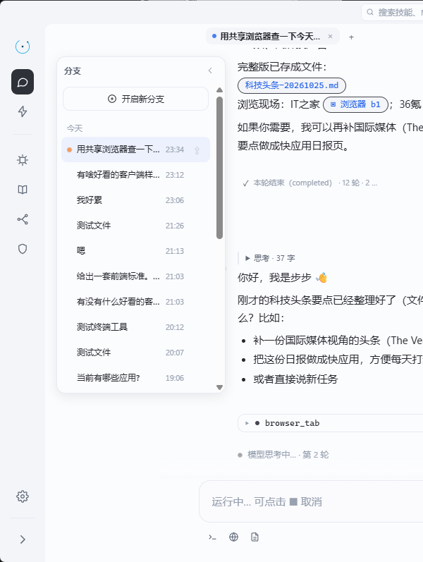
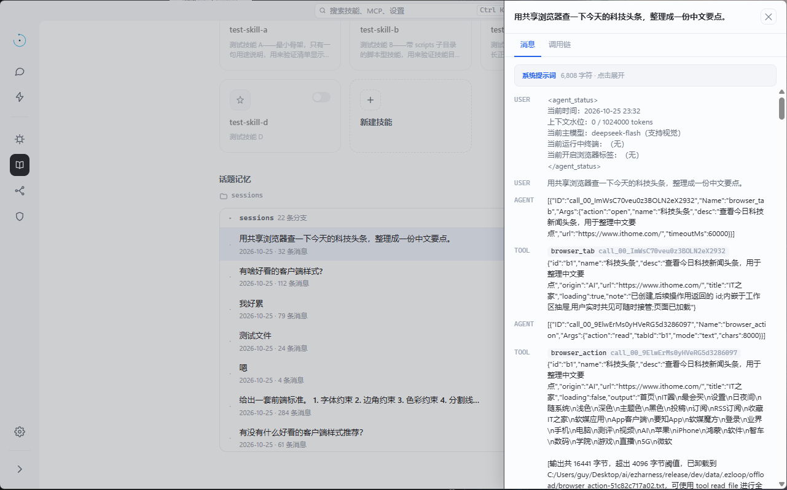
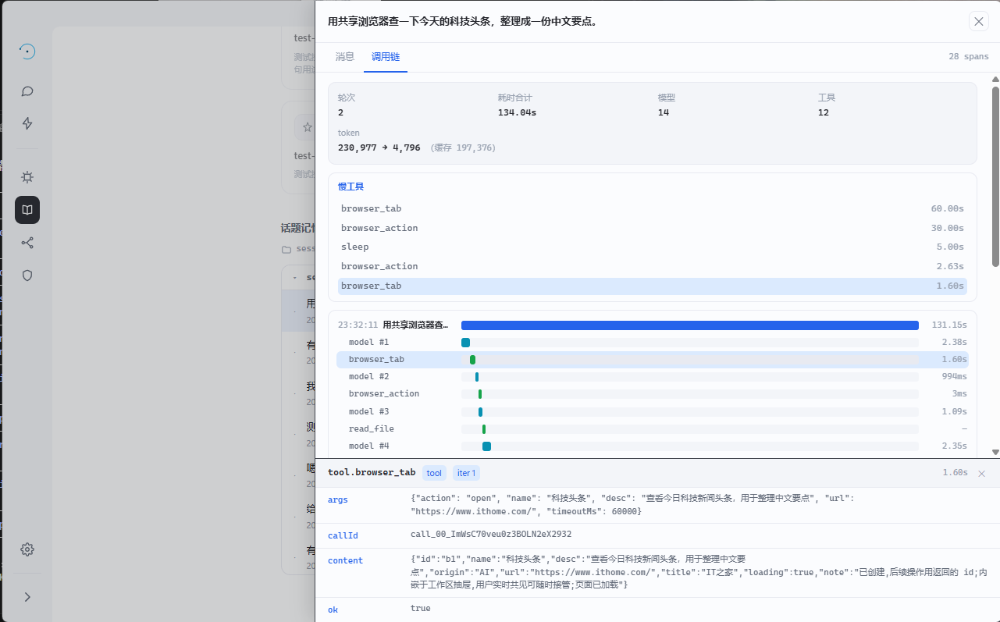
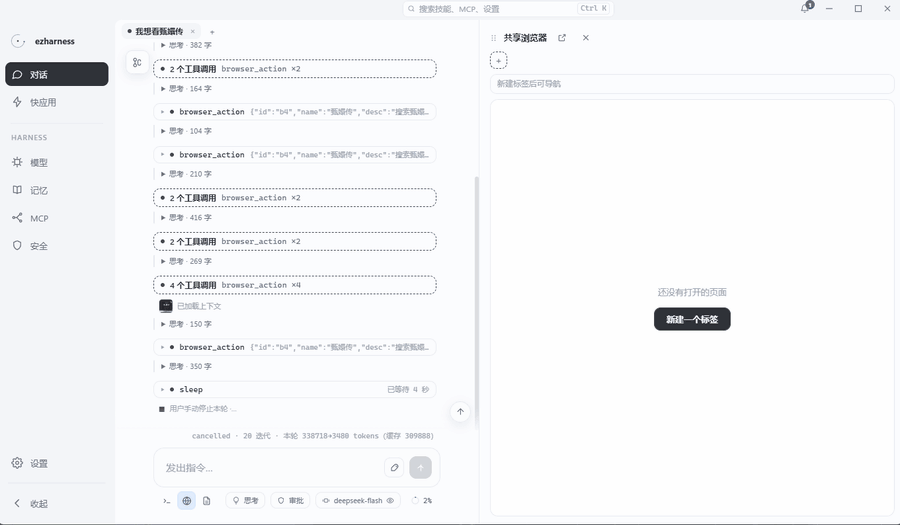

# session 管理

会话不是一条无限延伸的记录，而是一棵可生长、可回退、可沉淀的树。理解这套模型只需要两个词：**节点**和**线**。

<figure class="narrow">
  
  <figcaption>分支面板：每条线一个条目，当前线高亮，切换不打断后台轮次</figcaption>
</figure>

## 一、节点与线

| 概念 | 定义 | 用户看到的样子 |
| --- | --- | --- |
| 节点 | 一次换代内的完整消息库，存于 `sessions/<id>/` | 内部结构，不直接暴露 |
| 线 | 从某个根节点开始、不断向下的路径，身份是 `RootID` | 侧栏里的一个会话、一个标签 |

每次归档（compact）产生一个新节点，接在旧节点之后；线保持不变。用户切换分支，切换的是线的当前叶节点。

<figure>
  
  <figcaption>话题记忆列出全部线；点开一条线可看到轮次、工具与 token 的调用链</figcaption>
</figure>

## 二、分叉：复制语义

对一条消息点「分叉」时：

- 锚点按 1-based 计算，复制 `[0, anchor]` 的完整消息副本，包含选中的那条消息。
- 新节点继承源节点的 system 与上下文水位，`LineRoot` 指向自己，类型为 `fork`。
- 新线独立运行；空分叉链会继续向上溯源，直到找到有实际消息的节点。

分叉不是引用，也不是浅拷贝——它拿走的是一份完整的历史，所以两条线可以各自继续，互不影响。

`task` 工具也会产生分叉，但那不是用户可见的线，而是存放在 `forks/<forkId>/` 的分身：独立 `LoopState`，事件带 `forkId`，答案汇回主轮。

## 三、归档：沉淀后换代

归档不是「清空上下文」，而是一次有去无回的交接：

1. 旧节点标记 `Archived=true`，消息全部保留，可沿压缩链回读。
2. 先调用模型把会话内容沉淀进长期记忆（见第五节）。
3. 再由模型视图生成交接摘要，写入新节点的 `<compact-summary>`。
4. 新节点不继承消息与水位，继承线根、上下文窗口，以及当场重建的 base（重新读取记忆、技能、MCP、应用清单）。

旧世代的对话没有消失，只是从「上下文的一部分」变成「可回读的档案」。

## 四、存储与不变量

`sessions/<id>/` 下有两个关键文件：

- `session.json`：状态字段（ID、标题、system、摘要、线根、快照、用量、上下文水位、归档标记等）。
- `trace.jsonl`：事件流。消息本身不写进 `session.json`，而是从 `trace.jsonl` 的 message 行合成。

这样设计是为了保证一个不变量：

```
最终历史 = trace[0 : ViewStart] + FoldedOf(state) + state.Messages
```

含义是：**marker 之前的档案永远不被丢弃**。落盘时只向 trace 追加新尾部；如果内存中的历史发生回缩，落盘直接跳过，不会覆盖已有档案。

<figure>
  
  <figcaption>调用链把 trace 展开成轮次与工具跨度：耗时、token、参数与返回值都在</figcaption>
</figure>

`progress.md` 是修剪的副产物：每次 trim 整体重写，包含会话 id、最近时间、原文 trace 位置和四节摘要。系统提示的 `<session>` 段会给出它的绝对路径，模型据此恢复现场。

## 五、归档时如何合并记忆

归档时的记忆沉淀是一次模型调用，不是固定模板重写：

- 输入：现有 user / soul 条目、项目索引与项目正文、当前会话视图。
- 输出：JSON 形式的条目操作（增加 / 更新 / 删除）与项目操作（保存 / 删除）。
- 规则：新表述覆盖旧表述，过时内容删除，不保留一次性过程；user / soul 各不超过 30 条，项目正文不超过 40 行。
- 变更不直接写入正式记忆，而是落到 `memory/pending-ops.json`，等用户确认后生效。失败则静默跳过，不阻断归档。

## 六、后台运行与标签

- 每个线根对应一个常驻 `Session`，切换分支只改变 `SetActive`，不取消正在执行的轮次。
- 切回某条线时重新订阅事件；服务端先用整轮聚合帧重建界面，再回放未决请求（审批、提问）。
- 标签是纯前端外观，一个标签对应一条线的根。关闭标签会取消该线当前轮次——这是「关闭」应有的语义。

<figure>
  
  <figcaption>从分支面板开启新线，落成独立标签；新标签从空白工作台开始</figcaption>
</figure>

## 七、目录示例

```
data/
├── topics.json                 # 线索引：根 id → 当前叶 id
└── sessions/
    ├── s_8f2a/                 # 一个世代（节点）
    │   ├── session.json        # 状态
    │   ├── trace.jsonl         # 事件与消息
    │   └── progress.md         # 最近一次修剪的四节摘要
    └── s_8f2a-fork-1/          # 分叉产生的新节点
        ├── session.json
        └── trace.jsonl
```

---

上一篇：[模型配置](模型配置.md) · 下一篇：[上下文管理](上下文设计.md)
