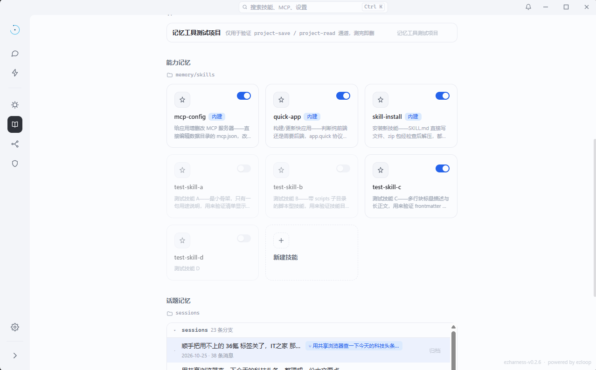

# skill 设计

技能（skill）是把「做过一次」变成「随时可复用」的方式。一个技能就是一个目录加一份 `SKILL.md`，不需要编译、不需要注册中心。

<!-- 截图占位：能力记忆（技能库）页面。放 docs/assets/skills.png 后取消下一行注释 -->
<!--  -->

## 一、目录即身份

```
memory/skills/
└── deploy-static-site/
    ├── SKILL.md          # 必须有
    ├── scripts/
    │   └── deploy.sh
    └── templates/
        └── nginx.conf
```

- 目录名就是技能身份，创建后不改。
- `SKILL.md` 是唯一入口；`scripts/`、`templates/` 等子资源由正文用相对路径引用，加载器不做解释。
- 用户技能位于数据目录的 `memory/skills/`。
- 内置技能用 `go:embed` 打进 core，不落到用户目录。

## 二、SKILL.md

加载器只消费 frontmatter 里的两个字段：

```markdown
---
name: deploy-static-site
description: 把静态站点目录发布到目标服务器并验证可访问
---

# 何时使用

用户要把本地静态页面发布到服务器时。

# 步骤

1. 读取 `templates/nginx.conf`，按站点名替换。
2. 执行 `scripts/deploy.sh <目录> <域名>`。
3. 用 `browser_action` 打开公网地址验证。

# 限制

需要目标服务器已配置 SSH 免密登录。
```

- `name` 缺省回落为目录名。
- `description` 缺省回落为正文首行。
- 两个字段都支持 YAML 的 `|` 与 `>` 块标量。
- 正文没有固定模板：什么时候用、怎么做、边界在哪，由作者决定。

## 三、内置技能

core 内置三个技能，随程序携带：

| 技能 | 用途 |
| --- | --- |
| `mcp-config` | 增删改 MCP server |
| `quick-app` | 构建 / 更新快应用，判断纯前端还是需要后端 |
| `skill-install` | 安装新技能：直接写 SKILL.md，或解压检查后的 zip |

它们和用户技能走同一套加载流程，只是标了「内建」，没有磁盘路径。

## 四、技能如何被模型看见

系统提示的 `<skills>` 段在会话创建时组装一次，每项形如：

```
- deploy-static-site: 把静态站点目录发布到目标服务器并验证可访问
- mcp-config〔内建〕: 增删改 MCP server
```

规则：

- 只注入名称与描述，**正文不常驻上下文**，避免技能多时挤占窗口。
- 被停用的技能只保留名称，并单独列出，让模型知道「有但不可用」。
- 模型需要正文时调用 `load_skill(name)`。

## 五、load_skill 返回什么

一次加载返回三部分：

1. `# skill: <名称>` 标题与磁盘路径（内建技能没有路径）。
2. 两层目录树，让模型知道有哪些脚本和模板可用。
3. 去掉 frontmatter 后的 SKILL.md 全文。

找不到技能时，返回可用技能名列表，而不是一句空错误。

## 六、变更如何通知模型

技能是会话期资源，可能在对话中途被新增、修改或删除。内核不要求模型轮询，而是在下一轮开头插入 `<resource_change>`：

- 会话开始时只建立资源基线，不报变更。
- 之后对比基线，报告可用的 skill / mcp / app / model 清单变化。
- 同时发 `resource.change` 事件给前端；基线与会话一起落盘，重启后仍能正确比较。

## 七、与「能力记忆」的关系

记忆页把技能库称为「能力记忆」，因为两者都在积累「怎么做事」。区别在存储与生效方式：

- 技能是文件：增删改通过文件系统或 API，`DisabledSkills` 控制启停，**下一个会话生效**。
- 长期记忆是条目：由 `memory` 工具写入，先进待确认队列，用户确认后生效。

技能适合「流程与脚本」，长期记忆适合「事实与偏好」。

---

上一篇：[上下文管理](上下文设计.md) · 下一篇：[MCP 设计](mcp设计.md)
