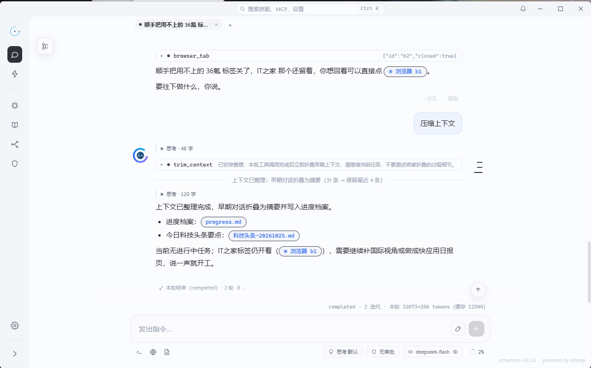
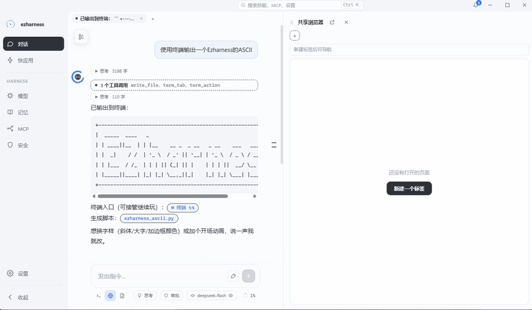

# 上下文管理

上下文窗口是有限的，但工作可以很长。ezharness 不追求「塞得更多」，而是保证模型在任何一轮都知道三件事：**我是谁、我在哪、用户刚做了什么。**

<figure>
  
  <figcaption>修剪后留一条分割线，早期对话折叠为摘要并写入 <code>progress.md</code></figcaption>
</figure>

## 一、系统提示由什么组成

每个会话的 system 只有一个来源：`base + identity + summary`。base 在会话创建时组装一次，快照恢复时不重组；此后每轮只重写 `Messages[0]`。

base 的段落顺序固定：

| 段 | 内容 | 何时变化 |
| --- | --- | --- |
| 人设 / SystemExtra | 角色与用户追加的行为要求 | 设置变更后新会话生效 |
| `<workspace>` | 可写目录与行为规则 | 数据目录 / 工作目录变化 |
| `<memory>` | user / soul 全部条目 + 项目索引 | 记忆变更 |
| `<skills>` | 技能名、描述、内建标记；停用者只列名 | 技能增删改 / 启停 |
| `<apps>` | 快应用清单：名称、标题、版本、描述、是否可调用 | 应用增删改 |
| `<models>` | 模型槽位与可调用清单 | 模型配置变化 |
| `<mcp>` | MCP server 与工具摘要 | MCP 配置变化 |
| `<local_api>` | 本机 API 与鉴权说明 | 固定 |
| `<action>` | 行动准则 | 固定 |
| `<output>` | 输出格式规范（可点击入口等） | 固定 |

随后是实时段 `<session>`（会话 id、标题、工作目录、进度档案路径）与归档后的 `<compact-summary>`。工具注册阶段再追加 `# 系统环境` 和六段 `<tool-guide>`（skill / approve / askuser / task / mcp / trim）。

注意两个「不注入」：

- **项目记忆正文不注入**，只给索引；模型需要时用 `memory` 工具的 `project-read` 读取。
- **话题树（topics）不注入**，它只是侧栏与切换用的索引，不是上下文。

## 二、修剪：按水位折叠

触发条件与参数：

| 项 | 值 |
| --- | --- |
| 水位 | `contextWindow × trimPercent / 100`，默认 75%，0 表示禁用 |
| 判断时机 | 每轮工具执行后的 `OnLoop`，读取上一次模型响应的 `PromptTokens` |
| 主动调用 | `trim_context` 工具（只在工具前登记，统一到 `OnLoop` 执行） |
| 摘要超时 | 5 分钟；超时则不阻塞本轮 |

修剪后的历史形状：

```
[system 与种子消息] + [最近 4 条] + <context_trim kept="N"> 摘要 </context_trim>
```

折叠范围会向前扩展，避免切出「有 tool_result 没有 tool_call」的孤儿序列。折叠掉的原始消息挂在 marker 的 `trim_folded` 元数据里，回读与落盘时拼回，不丢档。

<figure>
  
  <figcaption>也可以直接说「压缩上下文」：本轮结束后折叠，摘要与档案一起落地</figcaption>
</figure>

### 四节摘要

摘要不是自由发挥，而是固定四节：

```
【已完成】
【正在做】
【待办】
【关键事实】
```

缺节补「（无）」；四节全缺时退化为单一【关键事实】。摘要同时整体重写 `sessions/<id>/progress.md`，包含会话 id、最近时间、原始 trace 位置和这四节内容。模型下一次可以从档案恢复现场，而不是依赖已经折叠掉的消息。

## 三、卸载：大结果不进上下文

工具结果经常远大于对话本身。处理分两层：

| 机制 | 阈值 | 行为 |
| --- | --- | --- |
| offload | 默认 4096 字节，设置上限 1MB | 写入 `.ezloop/offload/<tool>-<hash>.txt`，上下文留 512 字节头 + 绝对路径；写失败则原样透传 |
| guard | 按窗口余量估算（约 1.2 字符/token） | 兜底卸载；仍放不下则硬截断尾部 |

豁免名单：`ask_user`、`task`、`load_skill` 不卸载；`read_file` 是回放工具，也不卸载（防止「卸载→回放→再卸载」的死循环）。guard 专门补这些豁免项漏出的大结果，例如单行超长的文件读取。

## 四、记忆如何进入上下文

记忆不是一个文件夹，而是三种生命周期的信息：

| 记忆 | 进入上下文的方式 | 何时被写 |
| --- | --- | --- |
| 长期记忆 | user / soul 全部条目 + 项目索引 | 归档沉淀、用户确认的 `memory` 操作 |
| 能力记忆（技能） | `<skills>` 只列名称与描述，正文靠 `load_skill` | 技能文件增删改 |
| 话题记忆（会话树） | 不进入上下文，只作为切换索引 | fork / compact |

这样安排的原因是体量：长期记忆小且必须常驻，技能正文大而按需加载，话题树是导航而不是知识。

## 五、什么时候该看哪个文件

| 你想了解 | 看这里 |
| --- | --- |
| system 每段的确切文案 | `core/internal/service/agent_service.go` 的 `buildSystemBase` |
| 修剪与摘要细节 | `core/internal/hooks/trim.go`、`summarize.go` |
| 卸载与兜底 | `ext/hook/offload`（ezloop）、`core/internal/hooks/guard.go` |
| 存储不变量 | [session 管理](session设计.md) 第四节 |

---

上一篇：[session 管理](session设计.md) · 下一篇：[skill 设计](skill设计.md)
