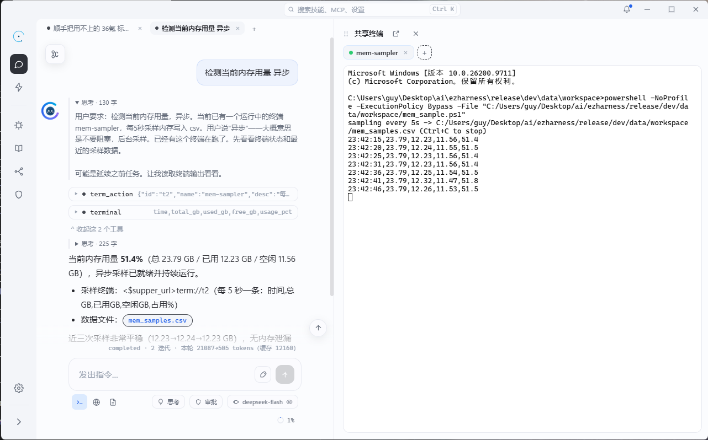
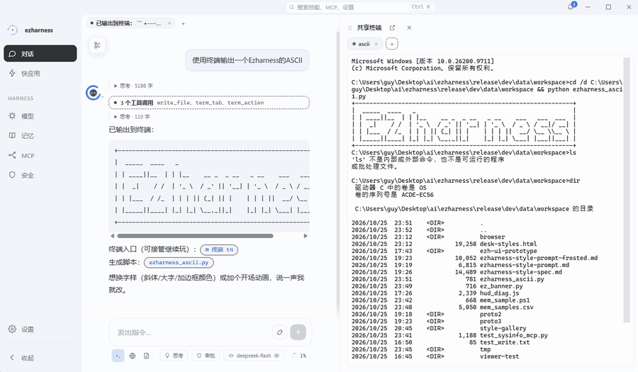
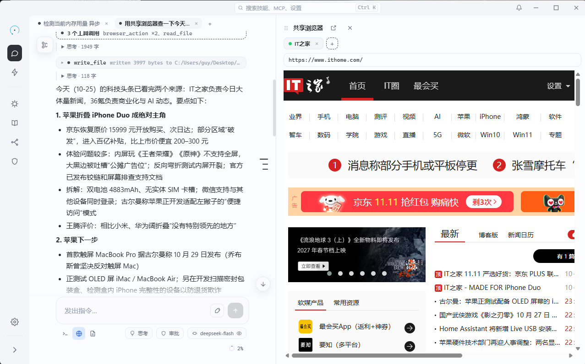
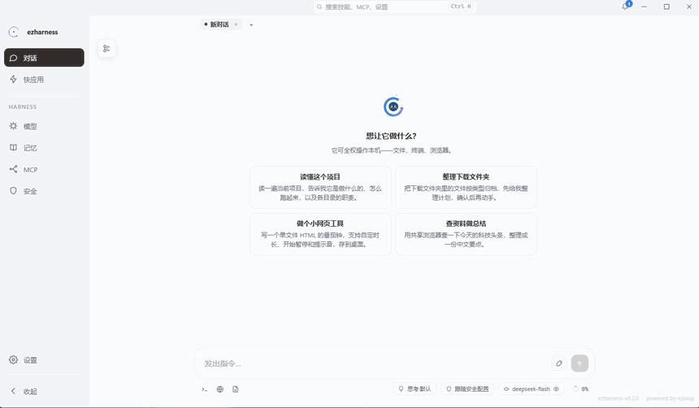
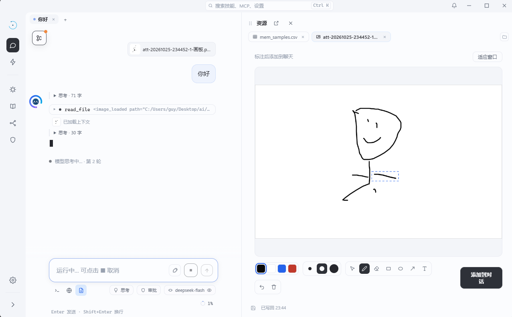

# 协同工具

「协同」不是让 AI 做完再把结果给你看，而是你们同时在一个真实环境里：同一个 shell、同一个浏览器页面、同一份文件。


## 一、共享终端

### 一个终端，两个写入方

每个终端是一个真实的 ConPTY 进程，id 依次为 `t1`、`t2`……。人和 agent 写的是同一个进程：

| 来源 | 路径 |
| --- | --- |
| 用户 | 前端 xterm → WS `input` → `UserInput` |
| agent | `term_action` 工具 → `writeAI` |

因此 `cd`、环境变量、正在运行的前台进程天然共享。agent 不需要「模拟用户的终端」，它就在用户的终端里。

<figure>
  
  <figcaption>右侧共享终端里运行着 agent 拉起的脚本，命令与输出对双方同时可见</figcaption>
</figure>

### 输出如何同时服务人和模型

PTY 输出由 `readPump` 双写：

1. **256KB ring buffer**：WS 断线重连时回放，用户重新看到最近的屏幕。
2. **屏幕语义重放**：维护终端屏幕状态，让 AI 读到的是「当前屏幕」，而不是原始转义序列流。

输出同时广播给所有订阅者。

### 模型如何执行命令

| 工具 | 行为 |
| --- | --- |
| `term_tab` | `new` / `list` / `close`，管理终端标签 |
| `term_action` `send` | 写入命令，等输出静默 800ms、最多 10 秒，返回前后屏差异 |
| `term_action` `read` | 读取末尾 N 行（默认 100），幂等 |

「静默 800ms」是在「等太短拿不到结果」和「等太久拖慢轮次」之间的折中。

### 生命周期

- 终端随 core 进程存活，core 重启后终端全部消失。
- 关闭终端或停机时杀进程树。
- shell 自己退出后，会话保留，仍可查看残留输出。

<figure>
  
  <figcaption>AI 在共享终端里执行命令，输出同时回到对话与终端</figcaption>
</figure>

## 二、共享浏览器

### core 只是桥

真实 Chromium 在 desktop 壳里，core 不直接持有页面。两者通过单条 WS `/api/browser/bridge` 转发 JSON-RPC，桥断 3 秒后重连。页面状态（标签、历史、DOM）全部在 desktop 侧。

<figure>
  
  <figcaption>共享浏览器是真实 Chromium：agent 打开、点按、读取的都是这一页</figcaption>
</figure>

### 每标签一个原生视图

- 每个标签一个 `WebContentsView`，id 为 `b1`、`b2`……
- 同一时刻只有一个视图挂在宿主窗口上，切换标签就是换挂载。
- `target=_blank` 就地开新标签，不弹系统浏览器。
- 从抽屉拖出成为独立窗口时，视图归该窗口所有；一个视图只能归一个窗口。

### 工具

| 工具 | 动作 |
| --- | --- |
| `browser_tab` | `open` / `list` / `select` / `close` |
| `browser_action` | `navigate` / `read` / `eval` / `console` / `network` / `screenshot` / `upload` |

没有单独的 `click` / `type` / `scroll`——所有页面交互都走 `eval`，配合注入的 `__ezOne / __ezAll` 查询。少一套动作，就少一套需要同步维护的语义。

### 接管与截图

- 用户直接操作原生视图即可接管，不需要先让 AI 停手。
- 用户打开 DevTools 时，CDP 槽位让给用户，AI 操作暂停。
- 截图支持视口、整页（按视口分段，最多 5 段）、单个元素；CDP 失败时退化为 `capturePage`。
- 截图落盘 `workspace/browser/`，并以图片消息回填上下文。

<figure>
  
  <figcaption>让 agent 查资料：标签、翻页、结果整理都在同一页完成</figcaption>
</figure>

## 三、资源页

### 查看器按类型路由

`frontend/src/components/viewer/registry.ts` 统一决定用哪个查看器：

| 类型 | 能力 |
| --- | --- |
| text / markdown / html | 编辑器，可保存 |
| image | 画板，可标注并写回 |
| pdf / media / excel / word / ppt | 只读查看 |
| 其他 | fallback 占位 |

保存走 `POST /api/workspace/save`，上限 2MB；图片走 `save-bin`。支持 Ctrl+S；干净标签每 2 秒 HEAD 轮询自动重载，有未保存修改时只提示、不覆盖。

<figure>
  
  <figcaption>资源页里直接圈注图片，标注以引用形式回填给 agent</figcaption>
</figure>

### 引用不是复制

把文件发给 AI 时，发送的是引用：

```json
{
  "path": "D:/work/spec.md",
  "items": [{ "sel": "…", "note": "这里要改", "from": 12, "to": 18 }]
}
```

这一轮会插入 `<reference_file>` 消息，模型按需 `read_file`。片段不会自动塞进上下文——引用是「告诉它去哪看」，不是「替它读完」。

当前资源页按钮产生整文件引用；片段标注的协议已经打通，文本查看器的标注界面尚未接入。

## 四、工作区抽屉

三个工具共用一个右侧抽屉：

- 终端、资源、浏览器三页互斥显示，但常驻保活；切换只改可见性，不销毁状态。
- 从抽屉拖出或点按钮可变成独立窗口；关窗后回落到抽屉原位置。
- 资源页有快照序列化；浏览器视图随宿主窗口转移；终端靠 WS 重连续屏。
- AI 打开新浏览器标签时，抽屉会自动切到浏览器页。

---

上一篇：[MCP 设计](mcp设计.md) · 下一篇：[快应用](快应用.md)
