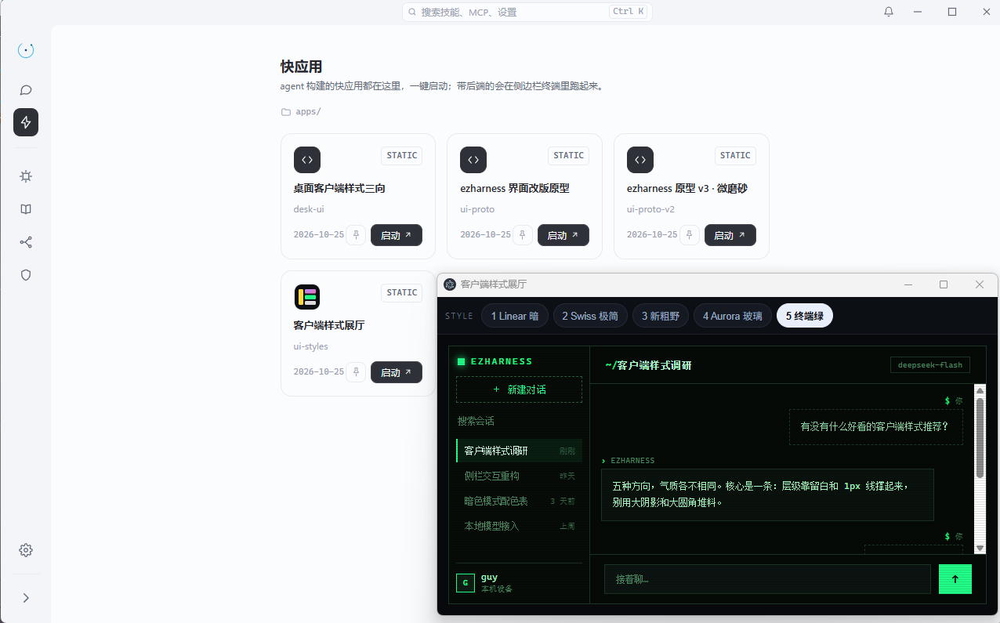
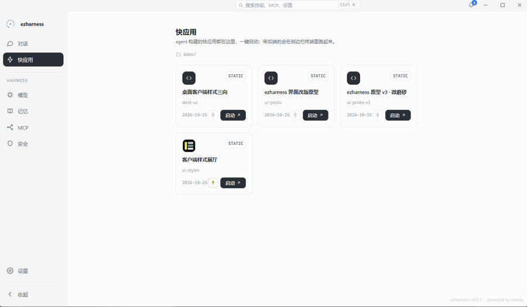
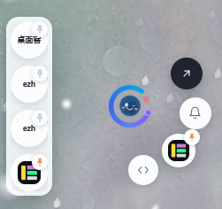

# 快应用

> 聊天里的代码是一次性建议；快应用是可打开、可迭代、可被 agent 再次发现和调用的软件单元。

<figure>
  
  <figcaption>快应用页：每个目录一张卡片，点「启动」开独立窗口</figcaption>
</figure>

## 一、它是什么

快应用（quick app）是 ezharness 定义的一种应用形态：由 AI 现场构建、快速迭代、人与 agent 共用。

一个快应用就是一个目录：

```
apps/certprobe/
├── app.quick          # 应用声明：它是谁
├── index.html         # 前端入口：人看到什么
├── APP.md             # 调用文档：agent 怎么用
├── CHANGELOG.md       # 版本记录
└── server.py          # 可选：后端进程
```

它不绑定技术栈。纯 HTML/JS 可以是快应用，带本机后端的也可以是快应用。协议只回答三个问题：

1. 它如何被发现？
2. 它如何启动？
3. 它如何描述自己、以及如何被 agent 调用？

除此之外——页面怎么写、接口长什么样、用什么框架——协议一概不管。

它也不只是一层界面。应用页由 core 注入令牌桥，页内 fetch 自动携带令牌，可以直接调用 ezharness 暴露的 `/api/model/call` 与 `/api/mcp/call`：需要判断时问模型，需要外部能力时调 MCP。一个快应用因此可以是**能自己干活的本地服务**，而不是只会展示结果的壳。

<figure>
  
  <figcaption>agent 构建的应用都以卡片出现在快应用页，点「启动」即可打开</figcaption>
</figure>

## 二、它要解决的问题

让 AI 做一个小工具，今天通常得到三种东西：

| 产出 | 问题 |
| --- | --- |
| 聊天里的一段代码 | 关掉对话就散落，下次要用还得重新生成 |
| 一个 HTML 文件 | 能打开，但 agent 下次不知道它存在，也不知道怎么调用 |
| 一个部署到云端的服务 | 重、慢、数据离开本机，且与对话上下文断开 |

三者共同的缺口是：**产出物没有可持续的身份，也没有对 agent 的接口。**

快应用补的正是这两个缺口：

- 目录名就是身份，`app.quick` 让系统能发现和启动它。
- `APP.md` 让 agent 知道它存在、能做什么、怎么调用。
- 它跑在本机，数据与能力都留在本机。

## 三、一份应用，三个消费者

| 消费者 | 如何接触应用 |
| --- | --- |
| 人 | 点开卡片，看到 `entry` 指向的界面，直接操作 |
| agent | 从系统提示的 `<apps>` 清单发现它，读 `APP.md`，按其定义调用 |
| 内核 | 读取 `app.quick` 启动前端/后端，跟踪版本与资源变更 |

同一份应用，人用的是界面，agent 用的是文档定义的接口。不是「给人看的 UI」和「给 AI 的 API」两套东西，而是同一个软件单元的两种入口。

## 四、应用 → agent → 应用：把循环固化成代码

快应用不是这条链的终点，而是链上的一个节点：

1. **应用封装 MCP。** 一组 MCP 工具对人是命令与参数；对应用则可以变成界面与流程。散落的原子能力被收进一个可点、可填、可复用的入口。
2. **agent 使用应用。** 应用按 `APP.md` 暴露接口，agent 读文档、直接调用；需要时也可以接管页面。
3. **agent 再把流程固化成应用。** 当某条调用顺序反复出现，agent 不必每轮重新推理——把这串 MCP 工具（连同模型调用、文件操作）写进一个应用，交给代码按固定顺序执行。

第三步是快应用真正的位置：**把 agent 循环里反复出现的路径，固化成可执行的代码。**

### 为什么不让它留在循环里

同样一条流程，如果每轮都交给 agent 循环：每轮重新装配上下文、重新推理工具顺序；承受模型随机性与 token 成本；结果依赖模型当时的判断，而不是上次跑通的路径。

固化成应用后，执行路径是代码：

- **确定**：顺序、分支、重试、并发由代码决定，同样的输入走同样的路径。
- **快**：没有推理往返，工具调用与数据处理直接发生。
- **省**：常态执行不占对话上下文，也不消耗主循环的迭代预算。
- **可变**：应用是目录里的源码，agent 随时能改；`version` 与 `CHANGELOG.md` 记录每次演化。

这就是它与 skill 的分界：**skill 是每次加载进上下文、指导模型重新执行的过程知识；快应用把过程写成代码，执行时不再需要模型重新理解一遍。** 固化的是路径，不是能力边界。

固化也不等于僵化。应用内部仍可调用 `/api/model/call` 与 `/api/mcp/call`：代码负责骨架，模型负责需要判断的片段。**能用代码走完的部分，就不要回到循环。**

## 五、硬契约

只有五条规则不可协商：

1. 目录 `apps/<app-id>/` 下必须有 `app.quick`，否则不视为快应用。
2. `app-id` 就是目录名，全局唯一，创建后不改——它是身份，不是标题。
3. `entry` 指向的文件必须在应用目录内，不允许上溯到目录外。
4. 应用自包含：页面、脚本、素材、数据默认放在自己的目录里，不修改其他应用的文件。
5. `app.quick` 中未识别的字段一律忽略。

第五条是协议寿命的关键：新规范可以增加字段，旧内核不会因此崩溃；旧应用也不会因为内核升级而失效。

目录里的其他文件完全由应用自己组织，协议不干预。

## 六、app.quick

JSON 文件，声明应用的基本信息：

```json
{
  "title": "证书探测",
  "description": "探测域名 HTTPS 证书链与到期时间",
  "version": "1.1.0",
  "entry": "index.html",
  "backend": "python server.py",
  "icon": "icon.svg",
  "document": "APP.md"
}
```

| 字段 | 必填 | 说明 |
| --- | --- | --- |
| `title` | 否 | 人类可读名称；缺省取 entry 的 `<title>`，再缺省用目录名 |
| `description` | 否 | 一句话描述，用于应用列表与 agent 发现 |
| `version` | 否 | 语义化版本；建议每次交付都更新 |
| `entry` | 否 | 前端入口，相对应用目录，默认 `index.html` |
| `backend` | 否 | 后端启动命令，cwd 为应用目录；省略 = 纯前端 |
| `icon` | 否 | 卡片头像，应用目录内的图片文件名 |
| `document` | 否 | 调用文档路径，默认 `APP.md` |

`backend` 的存在与否决定应用形态：

- **纯前端**：只开窗，不起终端。适合本地工具、可视化、计算器、编辑器。
- **带后端**：开窗的同时，在共享终端里前台执行启动命令。适合需要文件系统、网络、长任务的场景。

## 七、APP.md：接口写在文档里

这是整套协议里最反直觉、也最关键的设计。

一个应用是否能被 agent 调用，**不由内核开关决定，也不由 `app.quick` 的字段决定**，只看它的文档：

- 文档存在，且包含「Agent 调用」（或 `agent call`）标题 → 对 agent 开放。
- 没有文档，或没有这一节 → 只面向人类。agent 仍可按用户要求用浏览器操作页面，但那只是代操作，不是应用接口。

### 为什么不做统一的 `app_call`

因为调用方式不应该由框架规定。

- 有的应用适合暴露一个页面内全局对象：`window.certprobe.probe(...)`。
- 有的应用适合 HTTP：`POST http://127.0.0.1:18731/api/probe`。
- 有的应用只适合 CLI：`./tool --domain example.com`。

如果内核提供统一的 `app_call`，就必须规定参数怎么传、结果怎么回、流式怎么办、文件怎么给——最终把应用形态写死。快应用反过来：**内核只负责发现和启动，接口由应用自己在文档里定义。**

### 文档必须写清的六件事

1. **入口**：从哪里调用（全局对象 / URL / 命令 / 文件）。
2. **输入**：参数名、类型、必填项。
3. **输出**：返回结构或可观察结果。
4. **副作用**：会改什么、会不会启动进程、会不会写文件。
5. **失败语义**：抛错、非 2xx、还是返回错误字段。
6. **就绪条件**：后端是否必须先启动、首次调用是否需要重试。

### 示例一：纯前端（页面内 JS）

```markdown
# Agent 调用

页面加载完成后，在页面上下文执行：

    window.certprobe.probe({ domain: "example.com" })
      → Promise<{ subject: string, expiresAt: string }>

无副作用，只读。
失败以 Promise reject 返回 Error(message)。
```

agent 通过 `browser_action` 的 `eval` 执行这段代码，结果直接回到对话里。

### 示例二：带后端（HTTP）

```markdown
# Agent 调用

POST http://127.0.0.1:18731/api/probe
Content-Type: application/json

{ "domain": "example.com" }

200 → { "subject": "...", "expiresAt": "..." }
非 2xx → { "error": "原因" }

后端由应用启动命令拉起；首次请求可能未就绪，按 3 次 × 300ms 重试。
```

agent 通过 `terminal` 或 `browser_action` 发起请求。

## 八、运行契约

### 同源伺服与受限令牌

应用页面由 core 在 `/apps/<app-id>/` 同源提供。`POST /api/apps/open` 返回一枚由主令牌与应用名派生的**受限令牌**，只放行 `model/call` 与 `mcp/call`（含 MCP OAuth 三接口）；首次打开会弹授权卡，列明“调用本机模型 / 调用 MCP 工具”两项能力，确认后长期有效。

HTML 响应注入令牌桥：从打开地址的 `?token=` 取令牌，存进独立的 `ez-app-token` 键（不碰主界面的 `ez-token`），给页内 fetch 补 `X-EZ-Token`。页面里可以直接：

```js
fetch('/api/mcp/call', { ... })   // 调用 MCP 工具
fetch('/api/model/call', { ... }) // 调用模型
```

页面里不要写 API Key；受限令牌调不了文件、设置、终端、浏览器等其余接口。

### 后端在共享终端里跑

- 启动命令以应用目录为 cwd，**前台**执行，送进共享终端——日志和生命周期都对用户可见。
- 不要后台化（`start /b`、`&`）：一旦脱离终端，日志、退出、进程树都失控。
- 同一来源的后端未退出时复用，不重复拉起。
- 没有就绪握手：窗口先开、后端后起，页面首次请求必须自带重试。
- 后端是独立端口，属于跨源；页面直接请求时，后端必须返回 CORS 头。

### 生命周期

| 事件 | 发生什么 |
| --- | --- |
| 打开 | `/api/apps/open` 返回入口与终端 id；开窗由桌面壳执行 |
| 关窗 | 只关窗口，不杀后端 |
| 关终端 | 后端进程停止 |
| 钉住 | 最多同时钉 3 个应用到顶栏 |

没有独立的「停止应用」动作：应用的生命周期跟着窗口与终端走。

<figure class="tiny">
  
  <figcaption>桌面宠物的环形菜单：可钉住 3 个快应用，点一下直接启动</figcaption>
</figure>

## 九、发现与变更

agent 不需要猜「现在有哪些应用」，系统会告诉它：

- `<apps>` 段在会话创建时固定，列出名称、标题、版本、描述、是否可调用。
- 轮内新增、更新、移除由 `<resource_change>` 在下一轮开头报告，并附完整清单。
- `load_app(name)` 读取元数据、应用文档与 `CHANGELOG.md`。
- `save_app` 写入 `app.quick` 与 `index.html`；其他文件用 `write_file` 创建。

这套结构与技能库同构：**清单常驻上下文，正文按需加载。** 清单很小，不会挤占窗口；文档很大，只在真正需要时读。

## 十、完整实例：从一句话到可复用应用

用户说：「帮我做个能查 HTTPS 证书到期时间的小工具。」

### 第一步：agent 创建目录

```
apps/certprobe/
├── app.quick
├── index.html
├── APP.md
├── CHANGELOG.md
└── server.py
```

`app.quick`：

```json
{
  "title": "证书探测",
  "description": "探测域名 HTTPS 证书链与到期时间",
  "version": "1.0.0",
  "entry": "index.html",
  "backend": "python server.py",
  "icon": "icon.svg"
}
```

`APP.md`：

```markdown
---
name: certprobe
description: 探测域名 HTTPS 证书链与到期时间
version: 1.0.0
---

# 能力
输入域名，返回证书主题、签发者、到期时间与剩余天数。

# Agent 调用
POST http://127.0.0.1:18731/api/probe
Content-Type: application/json

{ "domain": "example.com" }

200 → { "subject": "...", "issuer": "...", "expiresAt": "...", "daysLeft": 42 }
非 2xx → { "error": "原因" }

只读，无副作用。后端由 `python server.py` 启动；
首次请求可能未就绪，重试 3 次、间隔 300ms。
```

`CHANGELOG.md`：

```markdown
## 1.0.0 — 2026-10-25
- 首版：域名证书查询，返回主题、签发者、到期时间与剩余天数。
```

### 第二步：人打开、agent 调用

用户点「证书探测」卡片，看到输入框与结果表；窗口与后端终端同时出现。

agent 则按文档调用：

```js
await fetch('http://127.0.0.1:18731/api/probe', {
  method: 'POST',
  headers: { 'Content-Type': 'application/json' },
  body: JSON.stringify({ domain: 'example.com' }),
}).then((r) => r.json())
```

或者，如果应用是纯前端，agent 在页面里执行 `window.certprobe.probe(...)`。

### 第三步：第二天继续迭代

用户说：「加上链里每张证书，并支持导出 CSV。」

agent 不需要重新造一个应用：它认识 `certprobe`，读 `APP.md` 知道现有接口，直接修改目录里的文件，把 `version` 升到 `1.1.0`，在 `CHANGELOG.md` 追加一条，并在 `APP.md` 更新输出结构。

下一次对话，`<apps>` 清单里的版本号、`load_app` 返回的文档，都是新的。

**这就是快应用与传统「让 AI 写个页面」最根本的区别：第二次、第三次、第十次，它仍然找得到这个东西，并且知道怎么用。**

## 十一、它与相邻概念的区别

| 概念 | 回答的问题 | 形态 | 生命周期 |
| --- | --- | --- | --- |
| skill | 「这类事怎么做」 | SKILL.md + 脚本/资源 | 加载进上下文，指导过程 |
| MCP | 「外部能力在哪里」 | 工具服务器协议 | 长连接，提供工具 |
| 快应用 | 「做出来的东西是什么」 | 可运行的应用目录 | 持久存在，人机共用 |
| 普通网页 | 「打开看点什么」 | 单个 HTML | 需要人记住路径 |

四者互补：

- skill 教 agent **怎么做**，快应用是 **做出来的产物**。
- MCP 连接 **外部世界**，快应用运行在 **本机**，并可调用 MCP。
- 重复出现的 MCP 调用序列可以从循环里固化成快应用：**探索靠循环，重复靠代码**。
- 快应用不是网页的另一套写法，而是给网页补上 **身份、接口与生命周期**。

## 十二、为什么这可能是颠覆性的

不是因为它让 AI 能写网页——那早就能做到。而是因为它改变了交付物的性质：

### 1. 从「生成答案」到「生成工具」

一次对话的终点不再是一段文本，而是一个可以被打开、被调用、被继续修改的软件单元。产出的价值不再随对话关闭而消失。

### 2. 工具生态可以自举

agent 使用的工具，可以是它自己创建并迭代的。今天它写一个证书探测工具，明天另一个分支遇到同类需求，可以直接调用而不是重写。**工具不再只能由开发者预先写死，也可以从对话中长出来。**

### 3. 人与 agent 共享同一个形态

人类用界面，agent 用文档定义的接口，内核用声明管理生命周期。同一份文件同时服务三种消费者——而不是为 AI 单独做一套 API、为人单独做一套 UI。

### 4. 协议极简，接口延迟绑定

内核只规定发现、启动、描述。调用方式写在应用文档里，技术栈不受限，`app_call` 这种会把形态写死的中心化接口被刻意排除。结果是：应用可以活得比内核更久。

### 5. 本地优先

应用跑在本机 core 上，数据留在本机，能力（文件、终端、浏览器、MCP、模型）同源可用。不需要部署、不需要账号、不需要把数据传到第三方。

如果这几点同时成立，快应用改变的不是「AI 能写什么」，而是 **「AI 交付什么」**。

## 十三、边界与已知风险

一个诚实的协议要写清自己的边界：

- **它不是沙箱。** 快应用是运行在本机的文件与进程，能力等同于用户自己的程序。不要运行来源不明的应用。
- **受限令牌仍能调用模型与 MCP。** 应用调不了文件/设置/终端/浏览器，但 MCP 工具本身可能有读写能力；信任边界是应用目录本身，首次打开需用户授权。
- **清单是会话期固定的。** 应用数量增长后，`<apps>` 段会变长；当前没有分组或检索机制。这是有意的取舍：先保证发现可靠，再考虑规模。
- **弱模型可能不读文档就操作页面。** 那不违反协议，只是退化为人机界面代操作，而不是应用接口。
- **后端生命周期依赖终端。** 关窗不杀后端、关终端才停；端口冲突需要应用自己在文档里说明。
- **没有签名、没有市场、没有权限声明。** 版本语义与 `CHANGELOG.md` 是约定，不是强校验。

这些不是待修的 bug，而是当前形态的明确代价。协议越小，越需要作者自觉。

## 十四、FAQ

**快应用和 skill 有什么区别？**

skill 是可加载的过程知识（怎么做），快应用是可运行的产物（做出来的东西）。两者在发现机制上同构：清单常驻、正文按需加载。

**和 MCP 是什么关系？**

MCP 提供外部工具；快应用是本机应用，可以调用 MCP，也可以被 agent 通过浏览器或 HTTP 调用。二者正交。

**没有 `APP.md` 会怎样？**

应用仍可被人使用，但 agent 不会把它当作可调用接口；它只能按用户要求代操作页面。

**后端必须用 Python/Node 吗？**

不必。`backend` 是任意前台命令，能在应用目录里跑起来即可。

**应用能调用模型吗？**

能。令牌桥自动带上 `X-EZ-Token`，页面里直接请求 `/api/model/call`；也可以走 `/api/mcp/call` 使用 MCP 工具。因此应用可以自己完成「调用模型判断 + 调用 MCP 执行」的闭环，成为一个小型自动化服务。

**应用数据放哪？**

默认放应用目录内；需要外部位置时在文档里写清楚。不要默认写到目录之外。

**多个分支同时用同一个应用会怎样？**

应用页面与后端是全局资源；后端按来源复用，终端是共享的。数据竞争需要应用自己处理并在文档说明。

**更新版本会破坏已有调用吗？**

`entry` 与调用入口应尽量稳定；破坏性变更升 major，并在 `APP.md` 与 `CHANGELOG.md` 里写明。

## 十五、作者检查清单

- [ ] `app.quick` 存在，`entry` 在应用目录内
- [ ] `description` / `version` 已填
- [ ] 需要 agent 调用：文档含「Agent 调用」一节，入口/输入/输出/副作用/失败语义/就绪条件齐全
- [ ] 不需要 agent 调用：不要写这一节，应用自然保持人类专属
- [ ] `CHANGELOG.md` 已追加本次变更
- [ ] 有图标时给出 128×128 的 SVG / PNG
- [ ] 后端前台运行，端口与页面一致，或在文档写明
- [ ] 页面里没有密钥；需要 core 能力时走 `/api` 接口（令牌由 core 注入的桥自动携带）

---

上一篇：[协同工具](协同设计.md) · 下一篇：[工具快查](external.md)
