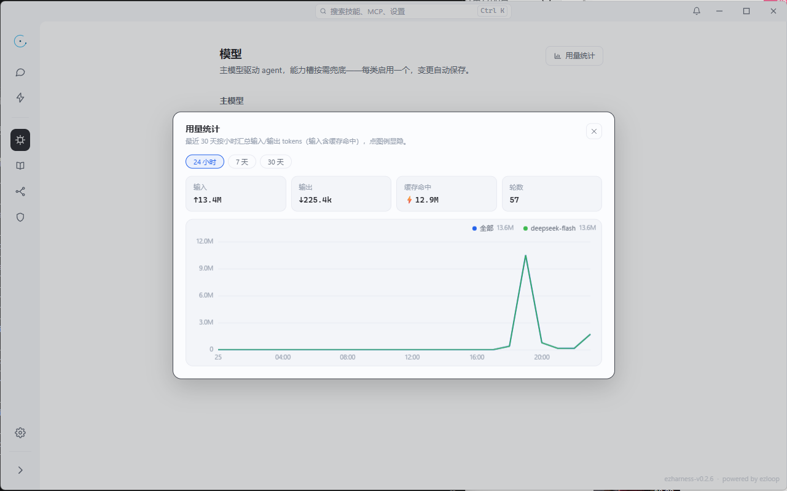

# 模型配置

模型配置决定两件事：谁来驱动 agent 主循环，以及在需要时由谁承担图片与音频能力。配置保存在数据目录的 `models.json`，与 `settings.json`（行为项）分开。


## 一、三个槽位

| 槽位 | 作用 | 约束 |
| --- | --- | --- |
| `main` | 驱动 agent 主循环；多模态时直接接收图片 | 不可为空，必须有启用项 |
| `image` | 供 `model_call` 或 task 按名调用的图像后端 | 可整槽停用 |
| `audio` | 同上，音频能力 | 可整槽停用 |

`image` / `audio` 不独立运行，它们是能力槽，由模型在任务中按名选用。

## 二、一条模型配置

```json
{
  "name": "deepseek-flash",
  "protocol": "openai",
  "baseUrl": "https://api.deepseek.com",
  "apiKey": "sk-...",
  "contextWindow": 128000,
  "vision": false,
  "headers": {},
  "enabled": true,
  "disabled": false
}
```

| 字段 | 含义 |
| --- | --- |
| `name` | 模型名，同时作为调用标识 |
| `protocol` | `openai`（默认）/ `responses` / `anthropic`，空串按 openai 处理 |
| `baseUrl` | 服务端点；三种协议使用同一组 apiKey / baseUrl / headers |
| `apiKey` | 为空仍可启动，但发消息会被拒绝 |
| `headers` | 附加请求头，用于网关、组织 ID 等 |
| `contextWindow` | 上下文窗口 tokens；`0` 表示未知，装配时按 128000 兜底 |
| `vision` | 主模型是否能把图片直接放进上下文 |
| `enabled` | 当前选用的那一条；每个槽至多一条启用 |
| `disabled` | 关闭该模型；关闭后不进入可选清单，`model_call` / task 也无法调用 |

`enabled` 与 `disabled` 不是一件事：前者是「现在用谁」，后者是「这条还能不能用」。

## 三、厂商预设

添加模型时提供两条预设，点击即回填五项：名称、端点、上下文窗口、视觉能力、协议。

- DeepSeek 官方
- 硅基流动（DeepSeek）

预设只负责减少填错，不限制你手动改任何字段。API Key 始终需要自己填。

## 四、生效时机

模型配置的变更不走「立即覆盖」：

1. 保存配置 → `POST /api/models`，后端重建 agent 装配（Reassemble）。
2. 若该分支正在运行，保存返回 409，等当前轮结束再改。
3. 成功后的提示是「下一轮生效」；运行中的分支在轮末切换到新装配。
4. 只切换主模型走 `/api/models/activate`，同样从下一次输入开始生效。

这样做避免在一轮对话中途换引擎，导致历史、上下文与工具状态错位。

## 五、视觉能力

`vision` 不是装饰字段，它改变请求形态：

- 开启时，图片消息原样进入上下文。
- 关闭时，`visionguard` 在请求副本中剥除所有图片，并把图片标记改写为带 `omitted` 说明的文本；落盘历史不受影响，换回多模态模型后自动恢复。
- 无视觉模型下，`read_file` 读取图片会被拒绝，浏览器截图改走文件路径，`model_call` 带图直接报错。

## 六、用量统计

每轮结束把用量写入 `stats.json`：

- 按本地小时分桶（`YYYY-MM-DDTHH`），字段 `turns` / `in` / `out` / `cache`，并按模型拆分。
- 小时桶保留 30 天；累计总量永久保留。
- `models.json` 的每条模型另有累计 `inTokens` / `outTokens` / `cacheTokens`。

前端两个入口：

- 模型页头的「用量统计」：24 小时 / 7 天 / 30 天，输入、输出、缓存命中、轮数与按模型折线。
- 对话页状态卡的缓存命中率与上下文水位。

<figure>
  
  <figcaption>用量统计：24 小时 / 7 天 / 30 天，输入、输出、缓存命中与轮数</figcaption>
</figure>

相关接口：`GET /api/stats/hourly` 返回小时桶；会话级水位走 `GET /api/status`。

## 七、配置模型的最小路径

1. 打开「模型」页，选择预设或手动填写。
2. 填入 API Key，确认协议与端点。
3. 保存，回到对话页发第一条消息。

如果 apiKey 为空，启动不会报错，但第一轮会明确提示缺少密钥——错误发生在真正需要模型的时候，而不是在启动时。

---

下一篇：[session 管理](session设计.md)
