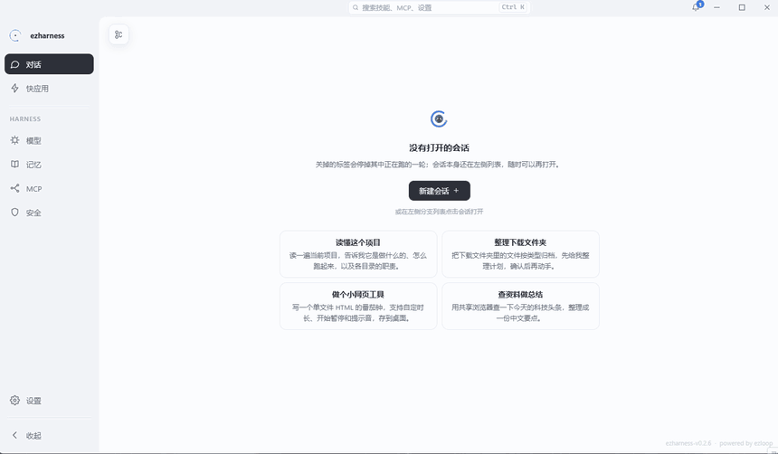

# 设计理念

> 限制一个 AI 助手的，往往不是模型的能力与接口，而是两道缺口：它伸不进真实世界，以及一次对话结束后，几乎什么也没留下。

ezharness 的每个机制都在回答三个问题：**怎么把世界交给它，怎么让工作台持续进化，又怎么把你留在旁边。**

## 一、把世界交给它

模型不缺推理，缺的是接触点。ezharness 不把 AI 关进沙箱再模拟世界，而是让它直接站在你的工作环境里：

- **真实的文件系统**：读写整台设备的文件，没有虚拟盘符。
- **真实的 shell**：agent 与用户共用同一个 ConPTY 进程，`cd`、环境变量、后台进程天然共享。
- **真实的 Chromium**：每标签一个 `WebContentsView`，agent 操作的就是你看到的那个页面。

能接触真实世界，才谈得上真正干活。

## 二、工具不是清单，是边界

把系统能力交给模型，等于把边界交给它。因此每个工具都带着约束：

| 约束 | 机制 |
| --- | --- |
| 谁能执行 | 四档审批：每次审批 / 黑名单 / 白名单 / 全免审 |
| 结果多大 | 超过阈值卸载到文件，上下文只留摘要与路径 |
| 跑多久 | 终端默认 600 秒，上限 3600 秒；模型调用 5 分钟超时 |
| 同时几个 | 同轮工具并发上限 4 |
| 出错怎么办 | panic 恢复为错误返回，不中断整轮 |

工具的价值不在于「能做」，而在于「在该做的时候做、在该停的时候停」。

## 三、把你留在旁边

能力越强，人越需要在场。ezharness 的交互设计围绕三个词：

- **可见**：命令输出、页面操作、每一步工具调用都在时间线里。
- **可接管**：共享终端随时输入，共享浏览器直接点原生页面，不需要先让 AI 停手。
- **可追责**：任何需要决定的地方都会出现审批卡；任何分支需要人时，顶栏通知一定能找到你。

## 四、对话是一棵树

线性聊天记录是机器日志，不是人思考的形状。

ezharness 的会话树只暴露两个动作：

- **分叉（fork）**：从任意一条消息复制完整前缀，开一条新线，探索另一种可能。
- **归档（compact）**：把长对话沉淀为记忆并换代，旧世代随时可回读。

一条线走不通，不必清空重来。

## 五、上下文是工作台，不是缓冲区

上下文窗口有限，但对话可以很长。ezharness 在对话过程中持续做三件事：

1. **修剪**：按模型窗口水位就地折叠，保留最近上下文。
2. **摘要**：折叠部分压缩为「已完成 / 正在做 / 待办 / 关键事实」四节，写入 `progress.md`。
3. **沉淀**：把值得留下的内容并入长期记忆，下次对话可用。

被折叠的对话不丢失，只是不再占着窗口。

## 六、交付物不是代码块

聊天窗口里的代码是草稿。真正的交付物应该能被打开、运行、复用，并在下一次被 agent 自己发现和调用。

这是快应用（quick app）的出发点：一个目录、一份 `app.quick` 声明、一份 `APP.md` 调用文档，就构成一个 agent 可以再次使用的软件单元。

<figure>
  
  <figcaption>一句需求做出可运行的番茄钟，写完就在共享浏览器里打开</figcaption>
</figure>

详见[快应用](快应用.md)。

## 七、刻意不做的事

- 不规定应用用什么技术栈。快应用协议只约定「如何被发现、如何启动、如何描述自己」。
- 不提供统一的 `app_call`。调用方式由应用自己的文档定义，框架不把形态写死。
- 不替用户做所有决定。审批、提问、通知，都是为了把决定留在人手里。
- 不追求「全自动」。真正的自动化不是没有人，而是人只在必要的地方出现。

---

下一篇：[模型配置](模型配置.md)
